# Alur Sistem QR Order

| | |
|---|---|
| Versi | 1.0 |
| Tanggal | 14 Oktober 2026 |
| Status | Draf alur untuk ditinjau. Melengkapi PRD v2 |
| Keterangan | Diagram ditulis dengan Mermaid (tampil otomatis di GitHub dan editor Markdown yang mendukungnya). Versi ini memuat diagram sebagai gambar PNG (folder `diagram/`) supaya tampil di editor mana pun. Sumber Mermaid tetap ada di bagian lipat di bawah tiap gambar. Kesembilan diagram sudah diuji dirender tanpa galat sintaks |

---

## 1. Asumsi yang dipakai

Beberapa hal belum diputuskan pemilik produk. Alur di bawah memakai asumsi ini, ditandai **[Asumsi]**, dan ada di bagian 12 untuk dikonfirmasi.

| # | Asumsi |
|---|---|
| A1 | Pelanggan **tidak wajib login** untuk memesan lewat website. Login hanya untuk fitur akun (riwayat, voucher, poin) |
| A2 | **Aplikasi Flutter** untuk pelanggan dan staf, dengan tampilan berbeda menurut **peran** |
| A3 | Voucher dan diskon hanya berlaku untuk **pengguna yang login** (di aplikasi) |
| A4 | Pesanan masuk ke dapur lewat **print agent** (printer struk + alarm) dan layar dapur |
| A5 | Pembayaran memakai QRIS lewat penyedia pembayaran (mock di awal) |
| A6 | Harga akhir, diskon, dan status pesanan **selalu dihitung dan diputuskan server** |

## 2. Gambaran besar


<details>
<summary>Sumber Mermaid (untuk diedit)</summary>

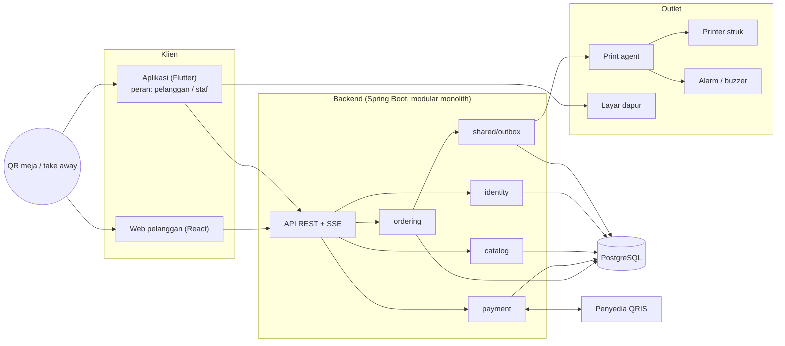

</details>

Intinya: satu backend, dua klien, dan satu jalur pemberitahuan ke dapur yang dipicu **hanya setelah pesanan lunas**.

## 3. Alur A: makan di tempat (scan QR meja)

QR meja berisi URL https, bukan skema khusus aplikasi, sehingga kamera HP biasa membukanya di browser.

```
https://pesan.contoh.id/o/<outlet>/meja/<token-meja>
```

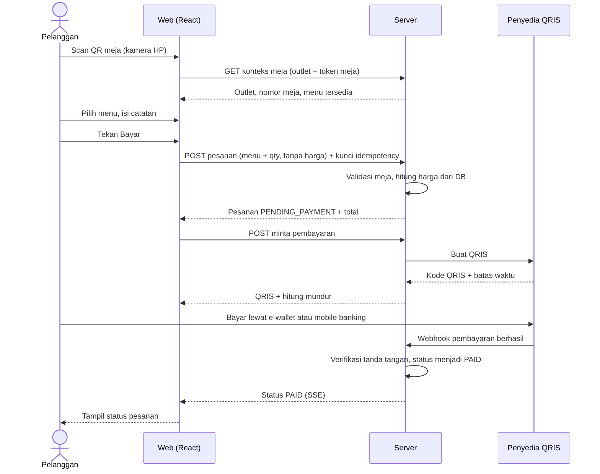

<details>
<summary>Sumber Mermaid (untuk diedit)</summary>

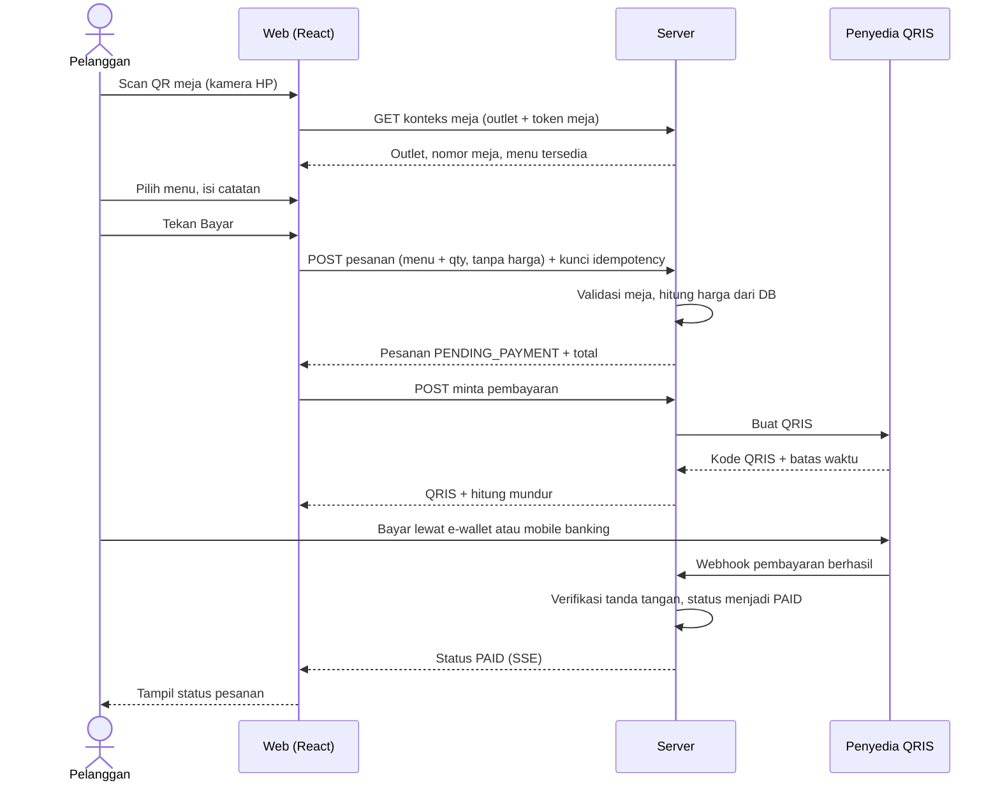

</details>

Poin penting:

- Klien **tidak pernah** mengirim harga. Server mengambil harga dari database.
- Kunci idempotency mencegah pesanan ganda bila tombol Bayar ditekan dua kali atau jaringan mengulang permintaan.
- Hanya **webhook** yang mengubah status menjadi `PAID`. Staf tidak bisa menandai lunas.

## 4. Alur B: take away

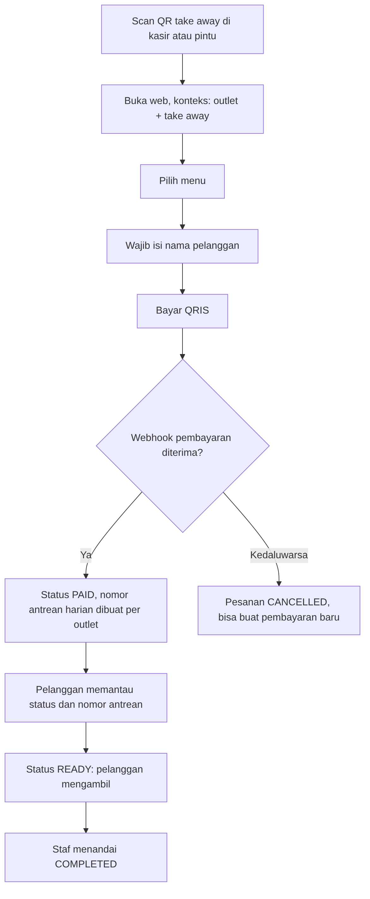

<details>
<summary>Sumber Mermaid (untuk diedit)</summary>

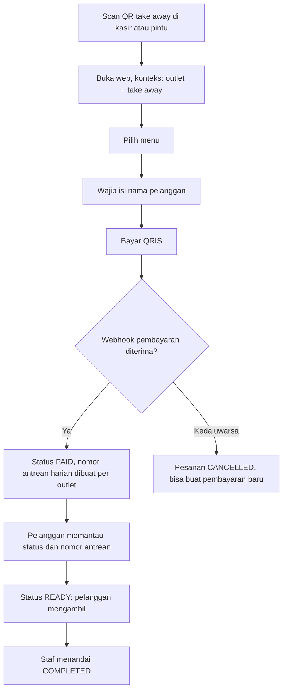

</details>

Nomor antrean unik **per hari bisnis per outlet** dan dibuat dengan penguncian database (`SELECT ... FOR UPDATE`) agar tidak ada dua pesanan dengan nomor sama.

## 5. Alur C: pelanggan di aplikasi (login, riwayat, voucher)

**[Asumsi A1, A3]** Aplikasi memberi nilai lebih daripada web: akun, riwayat, voucher.


<details>
<summary>Sumber Mermaid (untuk diedit)</summary>

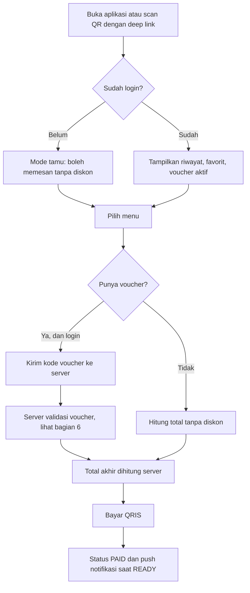

</details>

Aturan: aplikasi **tidak** menghitung diskon sendiri. Ia hanya mengirim kode voucher dan menampilkan hasil dari server.

## 6. Alur validasi voucher (di server)


<details>
<summary>Sumber Mermaid (untuk diedit)</summary>

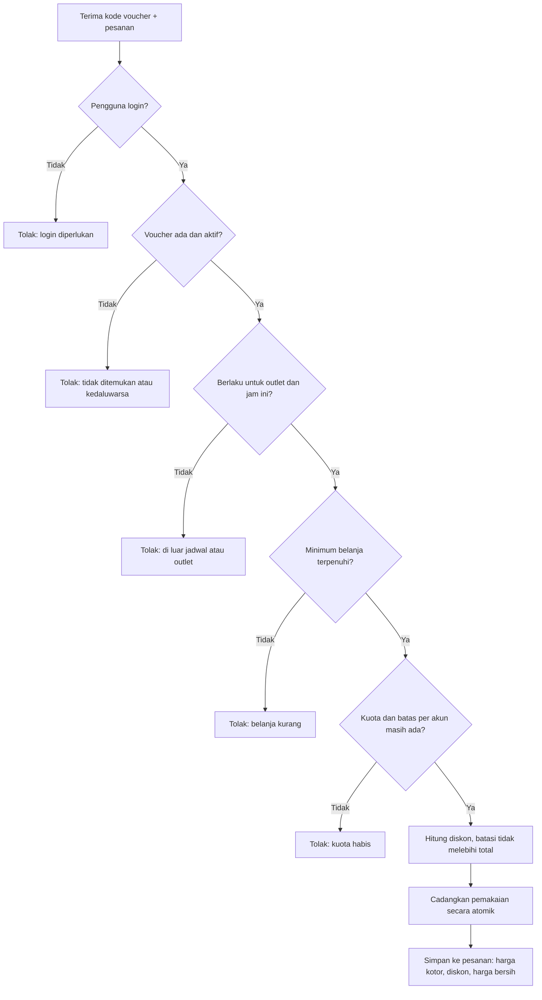

</details>

Aturan yang wajib:

| Aturan | Alasan |
|---|---|
| Pemakaian voucher **atomik** (kunci atau `@Version`) | Dua perangkat tidak boleh sama-sama memakai voucher satu kali pakai |
| **Idempoten** | Tekan bayar dua kali tidak boleh memakai voucher dua kali |
| Pesanan menyimpan harga kotor, diskon, harga bersih | Laporan dan rekonsiliasi QRIS harus cocok dengan total setelah diskon |
| Kebijakan refund jelas | Tentukan apakah voucher dikembalikan saat pesanan dibatalkan |
| Batas anggaran per promo | Mencegah promo merugikan tanpa terkontrol |

## 7. Alur pembayaran dan gangguan


<details>
<summary>Sumber Mermaid (untuk diedit)</summary>

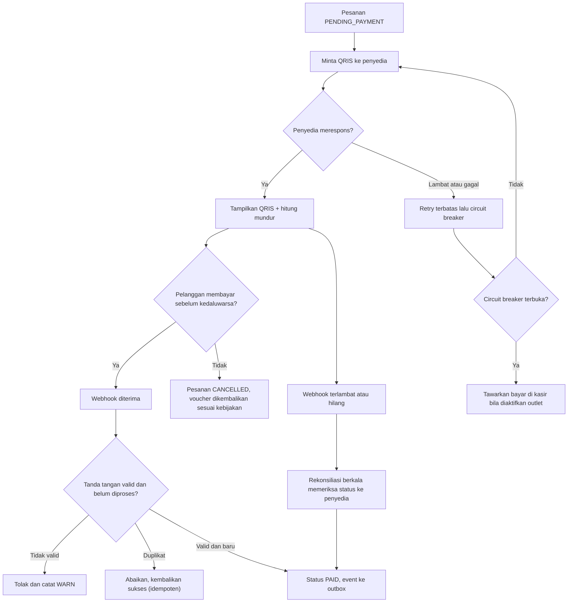

</details>

## 8. Alur pemberitahuan ke dapur (print agent / IoT)

Pemberitahuan dipicu **setelah pesanan `PAID`**, lewat pola outbox agar tidak ada pesanan lunas yang tidak sampai ke dapur.


<details>
<summary>Sumber Mermaid (untuk diedit)</summary>

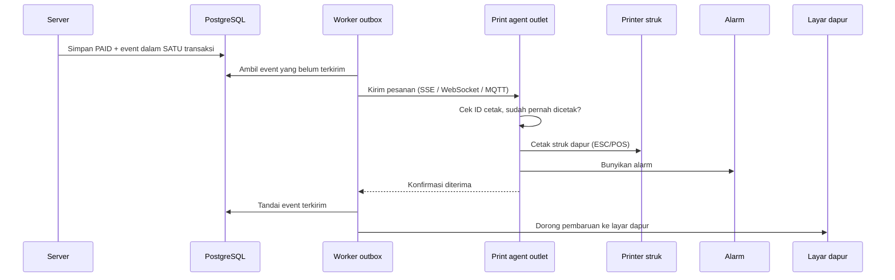

</details>

Aturan:

| Hal | Pendekatan |
|---|---|
| Event tidak boleh hilang | Ditulis ke tabel outbox dalam transaksi yang sama dengan status `PAID` |
| Cetak ganda | Setiap pesanan punya ID cetak. Agen tidak mencetak ID yang sama dua kali |
| Jaringan outlet putus | Agen menyimpan antrean lokal dan menyinkronkan ulang. Layar dapur menampilkan penanda "terputus" |
| Printer bermasalah | Tombol **cetak ulang** di layar dapur |
| Keamanan perangkat | Kredensial per perangkat, bisa dicabut, hanya menerima pesanan outlet-nya |

Catatan: alarm dan printer **hanya memberi tahu**. Perubahan status tetap dilakukan staf lewat layar (bagian 9).

## 9. Alur staf di aplikasi (berdasarkan peran)


<details>
<summary>Sumber Mermaid (untuk diedit)</summary>

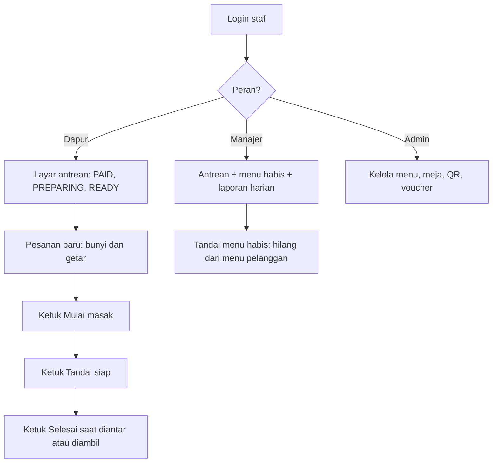

</details>

| Peran | Boleh | Tidak boleh |
|---|---|---|
| Pelanggan | Memesan, melihat status pesanannya sendiri, memakai voucher | Mengubah status, melihat pesanan orang lain |
| Dapur | Melihat antrean outlet-nya, mengubah status PREPARING, READY, COMPLETED, cetak ulang | Menandai `PAID`, mengubah harga, melihat outlet lain |
| Manajer | Seperti dapur + menu habis + laporan outlet | Mengubah data outlet lain |
| Admin pusat | Menu induk, outlet, peran, voucher | Menandai `PAID` secara manual |

Pembatasan peran dan outlet ditegakkan **di server**. Menyembunyikan tombol di aplikasi bukan perlindungan.

## 10. Siklus status pesanan


<details>
<summary>Sumber Mermaid (untuk diedit)</summary>

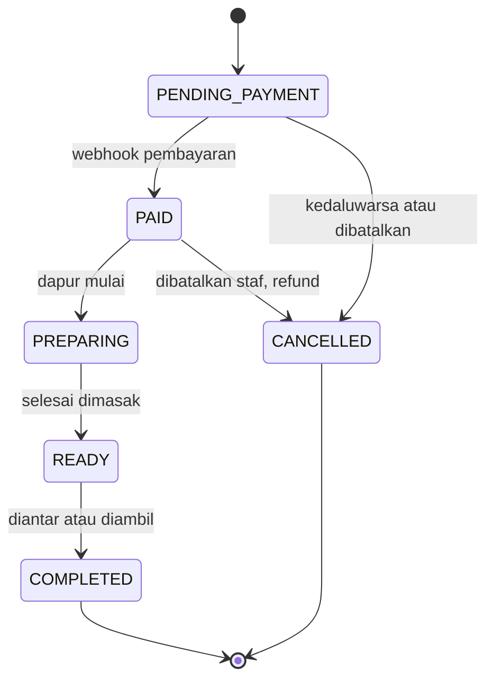

</details>

| Perubahan | Pelaku yang sah |
|---|---|
| `PENDING_PAYMENT` ke `PAID` | **Hanya sistem pembayaran** (webhook atau rekonsiliasi) |
| `PENDING_PAYMENT` ke `CANCELLED` | Sistem (kedaluwarsa) atau pelanggan |
| `PAID` ke `PREPARING`, `PREPARING` ke `READY`, `READY` ke `COMPLETED` | Staf dapur atau manajer |
| `PAID` ke `CANCELLED` | Staf berwenang, dengan refund dan jejak audit |

Pembatalan hanya diizinkan sebelum mulai dimasak. Setiap perubahan status dicatat (siapa, kapan, dari, ke) untuk audit dan data prediksi waktu siap.

## 11. Kegagalan dan perilaku sistem

| Gangguan | Dampak | Perilaku yang diharapkan |
|---|---|---|
| Penyedia QRIS lambat atau mati | Pelanggan tidak bisa membayar | Retry terbatas, circuit breaker, tawarkan bayar di kasir |
| Webhook terlambat atau hilang | Pelanggan sudah bayar tetapi status belum berubah | Tampilkan "menunggu konfirmasi", rekonsiliasi berkala |
| Webhook dikirim berulang | Risiko status atau voucher ganda | Pemrosesan idempoten |
| Internet outlet putus | Dapur tidak menerima pesanan | Agen menyimpan antrean lokal, layar menandai terputus, sinkron otomatis saat tersambung |
| Printer macet | Struk tidak keluar | Alarm dan layar dapur tetap berfungsi, tombol cetak ulang |
| Server restart | Koneksi SSE putus | Klien menyambung ulang otomatis dan menarik status terbaru |
| Dua perangkat memakai voucher sama | Pemakaian ganda | Pemakaian atomik, satu berhasil |
| Tombol bayar ditekan dua kali | Pesanan ganda | Kunci idempotency |
| Pelanggan menyisipkan harga atau diskon di request | Manipulasi harga | Server abaikan, hitung dari database |

## 12. Pemetaan ke fase

| Fase | Isi alur |
|---|---|
| **0. Fondasi** | Build hijau, Flyway, `outlet_id`, idempotency, `@Version`, indeks |
| **1. MVP pilot (1 outlet)** | Alur A dan B di web, QRIS (mock lalu sandbox), layar dapur, print agent dasar, admin menu dan meja |
| **2. Skala sedang** | Multi-outlet, peran per outlet, outbox + worker penuh, rekonsiliasi, circuit breaker, laporan, pagination |
| **3. Aplikasi dan promo** | Aplikasi Flutter (akun, riwayat, push, voucher, mode staf), poin atau stempel |
| **4. Skala padat** | Event bus, replica, gateway real-time, multi-penyedia pembayaran, AI |

## 13. Pertanyaan terbuka

1. Apakah pelanggan **wajib login** untuk memakai diskon, atau cukup memasukkan kode di web juga? (Asumsi A1 dan A3 hanya untuk aplikasi.)
2. Apa arti **"pembeda untuk staf"**: tampilan khusus peran, benefit atau diskon staf, atau keduanya?
3. Apakah dapur memerlukan **layar untuk mengubah status**, atau cukup printer dan alarm? (Alur di atas mengasumsikan layar diperlukan agar status pelanggan akurat.)
4. Protokol print agent: **SSE, WebSocket, atau MQTT**? (Untuk pilot, SSE atau WebSocket paling sederhana.)
5. Kebijakan voucher saat pesanan dibatalkan atau di-refund: dikembalikan atau hangus?
6. Apakah bayar di kasir (mode degradasi) akan diaktifkan, dan siapa yang mengonfirmasi lunas?
