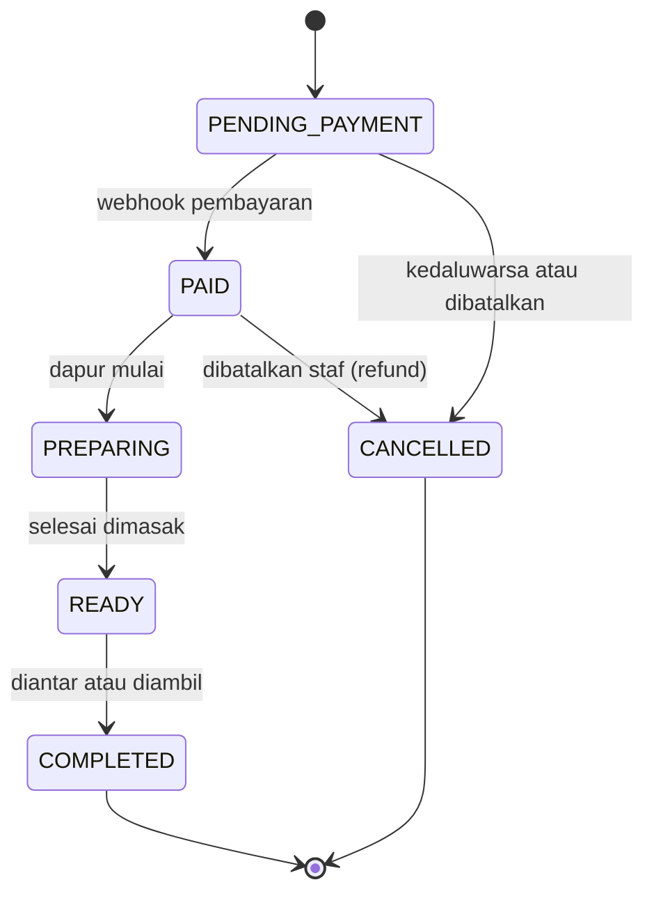
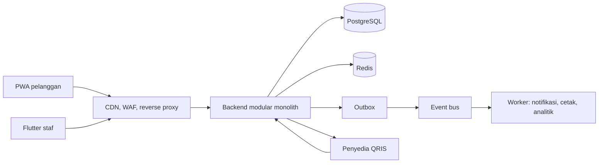

# PRD - QR Order v2.0
### Sistem Pemesanan Mandiri via QR (Makan di Tempat & Take Away) untuk Skala Sedang hingga Padat

| | |
|---|---|
| Versi | 2.0 (menggantikan 1.0) |
| Tanggal | 12 Oktober 2026 |
| Status | Draf untuk ditinjau |
| Pemilik produk | (isi) |
| Keterangan angka | Semua angka target, kapasitas, dan estimasi waktu adalah **usulan/asumsi** yang harus divalidasi dengan data outlet dan uji beban. Bukan data Gacoan atau pihak mana pun. |

### Perubahan dari v1.0

| Area | v1.0 | v2.0 |
|---|---|---|
| Skala | Satu outlet | Satu outlet sampai ratusan outlet, bertahap |
| Backend | Firebase (Firestore + Cloud Functions) | Modular monolith (Spring Boot) + PostgreSQL; backend awal sudah ada |
| Klien pelanggan | Aplikasi Flutter | Web (PWA) via QR, tanpa pasang aplikasi. Flutter untuk staf |
| Data | Satu outlet | `outlet_id` di semua tabel sejak awal |
| Ketahanan | Tidak dibahas | Idempotency, outbox, circuit breaker, rekonsiliasi, mode degradasi |
| Skalabilitas | Tidak dibahas | Pagination keyset, Redis, event bus, realtime gateway (bertahap) |
| AI | Tidak ada | Prediksi waktu siap, rekomendasi, asisten menu (dengan batasan) |
| Lampiran | Tidak ada | Peta topik teknis (RAG, Kafka, Redis, dst.), saran tambahan, rencana belajar |

---

## 1. Ringkasan Eksekutif

QR Order memungkinkan pelanggan restoran memesan dan membayar sendiri tanpa antre di kasir. Pelanggan memindai QR di meja (makan di tempat) atau QR take away, memilih menu, membayar lewat QRIS, lalu memantau status pesanan secara real-time. Pesanan yang **sudah dibayar** langsung muncul di layar dapur.

Produk dirancang untuk tumbuh dalam tiga tahap: **pilot satu outlet**, **skala sedang** (beberapa sampai puluhan outlet), lalu **skala padat** (ratusan outlet dengan lonjakan jam makan). Prinsip utamanya: **mulai sederhana, tetapi putuskan sejak awal hal-hal yang mahal diubah belakangan** (model multi-outlet, idempotency, model event, uang sebagai bilangan bulat).

## 2. Latar Belakang & Masalah

| Masalah | Dampak |
|---|---|
| Antrean kasir saat jam ramai | Pelanggan menunggu lama, kasir menjadi hambatan |
| Pencatatan manual rawan salah | Menu tertukar, catatan hilang, nomor meja salah |
| Bayar di akhir | Risiko pelanggan pergi sebelum membayar |
| Take away tanpa sistem antrean jelas | Pelanggan tidak tahu kapan pesanan siap |
| Pertumbuhan jumlah outlet | Menu, harga, laporan, dan peran staf harus dikelola per outlet |
| Gangguan pihak ketiga (pembayaran, internet outlet) | Operasional berhenti bila sistem tidak tahan gangguan |

## 3. Visi, Tujuan, dan Metrik

**Visi:** pesan sendiri secepat dan semulus mungkin, dapur menerima pesanan yang pasti dibayar, dan pemilik punya satu sistem yang tetap berjalan saat ramai maupun saat ada gangguan.

### Tujuan
1. Pelanggan menyelesaikan pesanan dari scan sampai bayar tanpa bantuan staf.
2. Dapur menerima pesanan real-time, jelas, dan hanya yang sudah dibayar.
3. Admin outlet mengelola menu dan meja tanpa bantuan teknis.
4. Pusat mengelola banyak outlet dengan peran dan laporan yang terpisah per outlet.
5. Sistem tetap berfungsi (secara terdegradasi) saat pembayaran, internet outlet, atau layanan pendukung bermasalah.

### Metrik keberhasilan (usulan)

North star: **persentase pesanan yang dibayar dan siap dalam target waktu tanpa intervensi staf.**

| Metrik | Definisi | Target usulan | Sumber data |
|---|---|---|---|
| Konversi checkout | Pesanan `PAID` / pesanan dibuat | ≥ 80% | `orders` |
| Waktu scan → bayar | Median, dari scan sampai `PAID` | ≤ 3 menit | event klien + `orders` |
| Waktu bayar → siap | p90 dari `PAID` ke `READY` | Ditetapkan per outlet setelah 2 minggu data | `order_status_history` |
| Latensi bayar → dapur | p95 dari webhook diterima sampai tampil di layar dapur | ≤ 5 detik | log + metrik |
| Kegagalan pembayaran karena sistem | Gagal bukan karena pelanggan | < 1% | `payments` |
| Kesalahan pesanan dilaporkan | Komplain salah pesanan / pesanan | < 2% | catatan staf |
| Ketersediaan jam operasional | Uptime saat outlet buka | Lihat bagian 10 | pemantauan |
| Biaya infrastruktur | Per 1.000 pesanan | Dilacak, target ditetapkan setelah pilot | tagihan cloud |

**Metrik pagar (guardrail):** pesanan ganda = 0; pesanan tidak sengaja ditandai lunas oleh non-sistem = 0; tingkat pembatalan dan refund dipantau agar tidak naik setelah rilis.

## 4. Non-Tujuan

- Pemesanan jarak jauh/delivery dan integrasi aplikasi ojek online.
- Manajemen stok bahan baku dan resep (bisa menjadi fase lanjutan).
- Program loyalitas lintas outlet (fase 3, opsional).
- Memecah menjadi microservice sebelum ada alasan terukur (lihat bagian 11).
- Menjamin informasi alergen lewat AI.

## 5. Persona

| Persona | Kebutuhan utama | Konteks |
|---|---|---|
| **Pelanggan makan di tempat** | Pesan cepat dari meja, harga jelas, tahu kapan makanan datang | HP sendiri, tanpa akun, sering terburu-buru |
| **Pelanggan take away** | Nomor antrean jelas, tahu kapan siap diambil | Berdiri di area ambil, memantau status |
| **Staf dapur/kasir** | Melihat pesanan baru yang sudah dibayar, ubah status dengan satu ketukan | Tablet/HP di dapur, tangan sibuk, suara bising |
| **Manajer outlet** | Atur menu dan ketersediaan, lihat riwayat dan laporan harian | Bukan teknisi |
| **Admin pusat** | Kelola outlet, peran, menu induk, laporan lintas outlet | Banyak outlet, perlu kontrol akses |
| **Pemilik/keuangan** | Rekonsiliasi pembayaran, laporan penjualan, pajak | Perlu data yang bisa diaudit |

## 6. Skala & Kapasitas (asumsi untuk perencanaan)

| | Tahap 1: Pilot | Tahap 2: Sedang | Tahap 3: Padat |
|---|---|---|---|
| Jumlah outlet | 1 | 5 - 30 | 100 - 500 |
| Pesanan puncak per outlet | ~60 per jam | ~100 per jam | ~100 per jam |
| Pesanan puncak total | ~60 per jam (sekitar 1 per menit) | hingga ~3.000 per jam (sekitar 0,8 per detik) rata-rata | ~30.000 per jam (sekitar 8 per detik) rata-rata, ~80 per detik saat lonjakan 10x |
| Koneksi real-time (pelanggan menunggu) | puluhan | ratusan | ~9.000 bila 30 per outlet |
| Pendekatan data | PostgreSQL tunggal | + index tepat, cache, replica | + partisi, replica, event bus |

Perhitungan contoh Tahap 3: 300 outlet x 100 pesanan/jam = 30.000 pesanan/jam, sekitar 8,3 per detik. Ini ringan untuk satu PostgreSQL yang dirancang baik. Yang lebih berat adalah **lonjakan jam makan**, koneksi real-time, integrasi pembayaran, dan internet outlet yang tidak stabil. Angka ini ilustrasi dan harus diganti dengan data nyata.

**Kesimpulan arsitektural:** bahasa pemrograman bukan penentu utama. Basis data, ketahanan, dan model event yang menentukan.

## 7. Ruang Lingkup & Fase

| Fase | Fokus | Isi utama |
|---|---|---|
| **0. Fondasi** | Dasar yang mahal diubah belakangan | Build hijau, Flyway, Testcontainers, `outlet_id` di model, index, idempotency, optimistic locking |
| **1. MVP pilot (1 outlet)** | Alur lengkap dipakai nyata | PWA pelanggan, Flutter staf, QRIS sungguhan (sandbox lalu produksi kecil), alert dapur, admin |
| **2. Skala sedang** | Multi-outlet dan operasional | Modul outlet, peran per outlet, laporan, pagination, cache Redis, outbox + worker, notifikasi, agen cetak, observability, CDN/WAF |
| **3. Skala padat** | Daya tahan di puncak | Event bus (Kafka), replica dan partisi, gateway real-time, autoscaling, multi-penyedia pembayaran, gudang data, fitur AI |

Detail dan kriteria selesai per fase ada di bagian 17.

## 8. Alur Pengguna

### 8.1 Makan di tempat
1. Pelanggan memindai QR meja, halaman web terbuka dengan konteks meja (`outlet` + `meja`).
2. Memilih menu, mengisi catatan, membuka keranjang.
3. Menekan **Bayar**. Pesanan dibuat `PENDING_PAYMENT`; harga dihitung server.
4. QRIS tampil dengan hitung mundur kedaluwarsa. Pelanggan membayar lewat e-wallet atau mobile banking.
5. Webhook penyedia mengubah status menjadi `PAID`. Halaman pindah ke status pesanan.
6. Dapur memproses: `PREPARING` → `READY` → `COMPLETED`. Pesanan diantar ke meja.

### 8.2 Take away
1. Pelanggan memindai QR take away di kasir atau pintu masuk.
2. Memilih menu dan **wajib mengisi nama**.
3. Membayar QRIS.
4. Menerima **nomor antrean harian per outlet** dan memantau status.
5. Saat `READY`, pelanggan mengambil pesanan; staf menandai selesai.

### 8.3 Dapur
1. Login staf. Layar menampilkan antrean aktif (`PAID`, `PREPARING`, `READY`) urut waktu masuk.
2. Pesanan baru memunculkan bunyi/getar. Ketuk **Mulai masak** → **Tandai siap** → **Selesai**.
3. Bila koneksi putus, layar menampilkan penanda "terputus" dan menyinkronkan ulang otomatis saat tersambung.

### 8.4 Pembayaran gagal atau tertunda
- QRIS kedaluwarsa: pesanan `PENDING_PAYMENT` dibatalkan otomatis; pelanggan bisa membuat pembayaran baru.
- Webhook terlambat: pelanggan melihat "menunggu konfirmasi"; sistem mengecek status ke penyedia secara berkala (rekonsiliasi).
- Penyedia pembayaran bermasalah: circuit breaker terbuka, aplikasi menawarkan **bayar di kasir** (bila diaktifkan outlet).

### 8.5 Siklus status pesanan



Aturan: staf **tidak bisa** menandai `PAID` secara manual; hanya sistem pembayaran. Pembatalan hanya sebelum mulai dimasak.

---

## 9. Kebutuhan Fungsional

**Prioritas:** P0 wajib untuk fase tersebut, P1 sangat diharapkan, P2 bernilai tetapi bisa ditunda.
**Status:** `Ada (BE)` sudah ada di backend Spring v1 (build belum diverifikasi), `Ada (FL)` sudah ada di klien Flutter v1 (berbasis Firebase), `Sebagian`, `Belum`.

### 9.1 Pelanggan (FR-C)

| ID | Kebutuhan | Prio | Fase | Status |
|---|---|---|---|---|
| FR-C1 | Memindai QR meja dan QR take away; konteks outlet + meja/take away terbaca dari QR | P0 | 1 | Ada (FL), perlu versi web |
| FR-C2 | QR tidak dikenali ditolak dengan pesan jelas | P0 | 1 | Ada (FL) |
| FR-C3 | Menu per kategori, hanya item yang tersedia | P0 | 1 | Ada (BE) |
| FR-C4 | Pencarian dan filter menu (Postgres full-text/trigram) | P1 | 2 | Belum |
| FR-C5 | Tambah/kurangi jumlah, catatan per item | P0 | 1 | Ada (FL) |
| FR-C6 | Take away wajib mengisi nama | P0 | 1 | Ada (BE) |
| FR-C7 | Checkout membuat pesanan; harga dan total dihitung server | P0 | 1 | Ada (BE) |
| FR-C8 | Pembayaran QRIS dengan hitung mundur kedaluwarsa | P0 | 1 | Sebagian (mock, tanpa kedaluwarsa) |
| FR-C9 | Perlindungan ketuk ganda: `Idempotency-Key` pada pembuatan pesanan | P0 | 0 | Belum |
| FR-C10 | Status pesanan real-time, dapat pulih setelah koneksi putus (snapshot + lanjut dari event terakhir) | P0 | 1 | Sebagian (SSE ada, tanpa resume) |
| FR-C11 | Nomor antrean take away, unik per outlet per hari | P0 | 1 | Sebagian (per hari, belum per outlet) |
| FR-C12 | Tanpa akun/login untuk pelanggan | P0 | 1 | Ada (BE) |
| FR-C13 | Catatan alergi sebagai teks bebas dengan penafian jelas (bukan jaminan) | P1 | 1 | Belum |
| FR-C14 | Pelanggan membatalkan pesanan sebelum dibayar | P1 | 2 | Belum |
| FR-C15 | Notifikasi pesanan siap (web push atau WhatsApp) | P1 | 2 | Belum |
| FR-C16 | Pesan ulang dari riwayat di perangkat | P2 | 3 | Belum |
| FR-C17 | Bahasa Indonesia dan Inggris | P2 | 3 | Belum |
| FR-C18 | Aksesibilitas: kontras, target sentuh, status tidak hanya lewat warna | P1 | 1 | Sebagian |

### 9.2 Dapur (FR-K)

| ID | Kebutuhan | Prio | Fase | Status |
|---|---|---|---|---|
| FR-K1 | Login staf dengan peran | P0 | 1 | Ada (BE) |
| FR-K2 | Hanya `PAID`, `PREPARING`, `READY` tampil di antrean | P0 | 1 | Ada (BE) |
| FR-K3 | Kartu pesanan: meja/nomor antrean, nama, item, jumlah, catatan, jam masuk | P0 | 1 | Ada (FL) |
| FR-K4 | Perpindahan status satu langkah per ketukan; dua staf menekan bersamaan tidak saling menimpa (optimistic locking `@Version`) | P0 | 0 | Sebagian (transisi ada, tanpa locking) |
| FR-K5 | Antrean real-time dengan snapshot awal | P0 | 1 | Ada (BE) |
| FR-K6 | Bunyi/getar saat pesanan baru | P1 | 1 | Belum |
| FR-K7 | Penanda keterlambatan (pesanan melewati target waktu) | P1 | 2 | Belum |
| FR-K8 | Tandai menu habis cepat dari layar dapur | P1 | 2 | Belum |
| FR-K9 | Cetak tiket dapur lewat agen cetak lokal di outlet | P1 | 2 | Belum |
| FR-K10 | Pembatalan dengan alasan dan jejak audit | P1 | 2 | Belum |
| FR-K11 | Routing per stasiun (mie, minuman, gorengan) | P2 | 3 | Belum |
| FR-K12 | Toleransi offline: antrean lokal dan sinkronisasi ulang | P2 | 3 | Belum |

### 9.3 Admin outlet (FR-A)

| ID | Kebutuhan | Prio | Fase | Status |
|---|---|---|---|---|
| FR-A1 | CRUD menu (nama, kategori, harga Rp, deskripsi, gambar) | P0 | 1 | Ada (BE) |
| FR-A2 | Saklar tersedia/habis | P0 | 1 | Ada (BE) |
| FR-A3 | CRUD meja dan tampil QR meja serta QR take away | P0 | 1 | Ada (BE: meja), Ada (FL: QR) |
| FR-A4 | Ekspor QR ke PDF siap cetak | P1 | 2 | Belum |
| FR-A5 | Riwayat pesanan dengan filter dan pagination keyset | P1 | 2 | Belum |
| FR-A6 | Laporan harian (penjualan, menu terlaris, waktu siap) dan ekspor CSV | P1 | 2 | Belum |
| FR-A7 | Kelola akun staf (buat, nonaktifkan, atur peran) | P1 | 2 | Belum (akun contoh via seeder) |
| FR-A8 | Unggah foto menu ke penyimpanan objek | P1 | 2 | Belum (hanya URL) |
| FR-A9 | Buka/tutup outlet dan jam operasional | P1 | 2 | Belum |
| FR-A10 | Jejak audit perubahan menu dan harga | P1 | 2 | Belum |

### 9.4 Multi-outlet dan pusat (FR-M)

| ID | Kebutuhan | Prio | Fase | Status |
|---|---|---|---|---|
| FR-M1 | Entitas `outlet` (nama, zona waktu, konfigurasi pajak) dan `outlet_id` di semua tabel bisnis | P0 | 0 | Belum |
| FR-M2 | Peran per outlet (RBAC): staf outlet hanya melihat outlet-nya | P0 | 2 | Belum |
| FR-M3 | Menu induk dengan override harga/ketersediaan per outlet | P1 | 2 | Belum |
| FR-M4 | Konfigurasi pajak daerah dan service charge per outlet | P1 | 2 | Belum |
| FR-M5 | Dasbor lintas outlet untuk admin pusat | P1 | 3 | Belum |
| FR-M6 | Promo dan voucher terpusat | P2 | 3 | Belum |

### 9.5 Pembayaran (FR-P)

| ID | Kebutuhan | Prio | Fase | Status |
|---|---|---|---|---|
| FR-P1 | QRIS dibuat di server; nominal dari pesanan di database | P0 | 1 | Sebagian (mock) |
| FR-P2 | Webhook diverifikasi sesuai penyedia (tanda tangan/token) | P0 | 1 | Sebagian (rahasia bersama) |
| FR-P3 | Webhook idempoten | P0 | 1 | Ada (BE) |
| FR-P4 | Kedaluwarsa QRIS dan pembatalan otomatis pesanan `PENDING_PAYMENT` | P0 | 1 | Belum |
| FR-P5 | Catatan pembayaran (`payments`) dengan jejak audit dan payload mentah | P0 | 1 | Belum |
| FR-P6 | Timeout, retry berbackoff, dan circuit breaker ke penyedia | P1 | 1 | Belum |
| FR-P7 | Rekonsiliasi berkala dengan penyedia (menangkap webhook yang hilang) | P1 | 2 | Belum |
| FR-P8 | Bayar di kasir sebagai cadangan operasional | P1 | 2 | Belum |
| FR-P9 | Alur refund | P1 | 2 | Belum |
| FR-P10 | Dua penyedia dengan failover | P2 | 3 | Belum |

### 9.6 Notifikasi (FR-N)

| ID | Kebutuhan | Prio | Fase | Status |
|---|---|---|---|---|
| FR-N1 | Pengiriman notifikasi lewat worker terpisah (tidak memblokir alur pesanan) | P1 | 2 | Belum |
| FR-N2 | Web push dan/atau WhatsApp saat pesanan siap | P1 | 2 | Belum |

### 9.7 Laporan dan analitik (FR-R)

| ID | Kebutuhan | Prio | Fase | Status |
|---|---|---|---|---|
| FR-R1 | Riwayat perubahan status (`order_status_history`) sebagai sumber waktu siap | P0 | 0 | Belum |
| FR-R2 | Laporan penjualan, menu terlaris, waktu siap per outlet | P1 | 2 | Belum |
| FR-R3 | Gudang data untuk analitik lintas outlet | P2 | 3 | Belum |

### 9.8 AI (FR-AI) - lihat bagian 14

| ID | Kebutuhan | Prio | Fase | Status |
|---|---|---|---|---|
| FR-AI1 | Prediksi waktu siap (model statistik sederhana lebih dulu) | P2 | 2-3 | Belum |
| FR-AI2 | Rekomendasi "sering dipesan bersama" di keranjang | P2 | 2-3 | Belum |
| FR-AI3 | Asisten menu berbasis LLM dengan batasan ketat | P2 | 3 | Belum |
| FR-AI4 | Peramalan permintaan per jam untuk persiapan bahan dan staf | P2 | 3 | Belum |
| FR-AI5 | RAG atas dokumen SOP/FAQ/panduan alergen resmi, hanya bila korpus besar (opsional) | P2 | 3 | Belum |

### 9.9 Platform dan rekayasa (FR-E)

| ID | Kebutuhan | Prio | Fase | Status |
|---|---|---|---|---|
| FR-E1 | Migrasi basis data dengan Flyway (bukan `ddl-auto: update`) | P0 | 0 | Belum |
| FR-E2 | Pengujian integrasi dengan PostgreSQL asli (Testcontainers) | P0 | 0 | Belum (test memakai H2) |
| FR-E3 | Index database pada jalur kritis (bagian 12) | P0 | 0 | Belum |
| FR-E4 | Pagination keyset untuk semua daftar yang bisa tumbuh | P1 | 2 | Belum |
| FR-E5 | Pembatasan laju (rate limit) pada endpoint publik | P0 | 1 | Belum |
| FR-E6 | Versi API (`/api/v1`) | P1 | 1 | Belum |
| FR-E7 | Kontrak API (OpenAPI) dan klien terbit otomatis | P1 | 2 | Belum |
| FR-E8 | Feature flag untuk rilis bertahap per outlet | P1 | 2 | Belum |
| FR-E9 | Transactional outbox untuk event keluar | P1 | 2 | Belum |

---

## 10. Kebutuhan Non-Fungsional

Semua angka adalah **usulan** untuk divalidasi dengan uji beban.

| Area | Kebutuhan | Tahap 1-2 | Tahap 3 |
|---|---|---|---|
| Latensi API | p95 buat pesanan (di luar penyedia pembayaran) | ≤ 400 ms | ≤ 300 ms |
| Latensi menu | p95 `GET menu` | ≤ 200 ms | ≤ 150 ms (dari cache) |
| Propagasi status | p95 perubahan status sampai terlihat klien | ≤ 3 dtk | ≤ 2 dtk |
| Ketersediaan | Saat jam operasional outlet | 99,5% | 99,9% |
| Pemulihan data | RPO (data hilang maksimum) / RTO (waktu pulih) | ≤ 15 mnt / ≤ 2 jam | ≤ 5 mnt / ≤ 1 jam |
| Skalabilitas | Penambahan outlet tanpa perubahan kode | Ya | Ya |
| Ketahanan | Gangguan penyedia pembayaran, Redis, atau layanan analitik tidak menghentikan pesanan di dapur | Wajib | Wajib |
| Konsistensi | Pesanan tidak ganda; nomor antrean tidak ganda; status mengikuti state machine | Wajib | Wajib |
| Keamanan | Lihat bagian 15 | | |
| Privasi | Data pelanggan minimal (nama untuk take away) | Wajib | Wajib |
| Kompatibilitas | PWA di browser mobile modern (Chrome, Safari); Flutter di Android/iOS yang didukung | | |
| Observability | Metrik, log terstruktur, tracing dan alarm (bagian 16) | Dasar | Lengkap |
| Pembaruan tanpa henti | Rilis tanpa mematikan layanan saat jam ramai | Diinginkan | Wajib |

---

## 11. Arsitektur Target

### 11.1 Prinsip
1. **Modular monolith dulu.** Satu unit deploy dengan modul berbatas jelas; pecah service hanya bila ada alasan terukur.
2. **Pesanan tidak boleh bergantung pada layanan sekunder.** Notifikasi, analitik, dan cetak berjalan asinkron lewat event.
3. **Server adalah sumber kebenaran** untuk harga, status, dan nomor antrean.
4. **Semua operasi tulis yang bisa diulang harus idempoten.**
5. **Tambah komponen hanya saat ada kebutuhan terukur** (Redis, Kafka, replica, gateway).

### 11.2 Gambaran komponen (tahap sedang menuju padat)



### 11.3 Stack per tahap

| Lapisan | Tahap 1: Pilot | Tahap 2: Sedang | Tahap 3: Padat |
|---|---|---|---|
| Klien pelanggan | PWA | PWA | PWA di belakang CDN |
| Klien staf | Flutter | Flutter | Flutter, mode offline-tolerant |
| Backend | Spring Boot modular monolith | Sama | Monolith inti + service terpisah yang terbukti perlu (payment, notifikasi, gateway real-time) |
| Basis data | PostgreSQL terkelola | + index, Flyway | + read replica, partisi `orders`, PgBouncer |
| Cache | Caffeine (di memori) | Redis | Redis (menu per outlet, rate limit, idempotency, pub/sub) |
| Event | Event internal Spring | Outbox + worker | Kafka atau layanan antrean terkelola |
| Real-time | SSE langsung | SSE + Redis pub/sub | Gateway real-time terpisah |
| Edge | Reverse proxy + TLS | + rate limit | CDN, WAF, anti-bot |
| Deploy | Container (Podman lokal) di layanan terkelola | Sama, multi-instance | Kubernetes terkelola, autoscaling, IaC |
| Observability | Actuator, log terstruktur, Sentry | + metrik, dasbor | OpenTelemetry, tracing, SLO |
| Analitik | Query ke replica | Laporan terjadwal | Gudang data |
| Identitas | JWT sendiri | + RBAC per outlet | OIDC (Keycloak/Auth0) |

### 11.4 Keputusan arsitektur dan pemicu meninjau ulang

| Keputusan | Pilihan | Alasan | Tinjau ulang bila |
|---|---|---|---|
| Gaya sistem | Modular monolith | Transaksi sederhana, satu deploy, tim kecil | Tim terpisah atau kebutuhan skala modul sangat berbeda |
| Bahasa inti | Java 21 (Spring Boot) | Ekosistem transaksi, keamanan, migrasi matang; sudah ada | Tim memiliki keahlian lain yang lebih kuat |
| Komponen tepi | Tetap di JVM dulu; Go bila perlu | Hindari dua stack sebelum perlu | Gateway real-time atau worker jadi hambatan biaya/memori |
| Basis data | PostgreSQL | Relasional, matang, partisi dan replica | Pola akses berubah drastis |
| Real-time | SSE | Satu arah (server ke klien), sederhana | Perlu komunikasi dua arah rendah-latensi |
| Antrean pesan | Outbox lalu Kafka | Kafka hanya bila banyak konsumen, replay, analitik | Satu-dua konsumen cukup dengan antrean ringan |
| Cache | Caffeine lalu Redis | Redis menambah operasional | Lebih dari satu instance backend |
| API gateway | Tidak ada; reverse proxy + CDN | Satu backend | Banyak service dengan kebutuhan routing/auth terpusat |
| Penomoran antrean | `SELECT FOR UPDATE` per outlet-hari | Benar dan sederhana | Kontensi tinggi per outlet (Redis `INCR` atau sequence) |
| Deploy | Container, Podman | Tanpa daemon, rootless | Perlu orkestrasi multi-service (Kubernetes) |

Struktur folder target (package-by-feature) ada di **Lampiran C**.

---

## 12. Model Data & API

### 12.1 Entitas utama (target)

| Entitas | Kolom penting | Catatan |
|---|---|---|
| `outlet` | id, nama, zona_waktu, konfigurasi pajak, jam_operasional | Baru di v2 |
| `menu_item` | id, outlet_id (atau master + override), nama, kategori, harga (bilangan bulat Rp), tersedia | Uang selalu bilangan bulat |
| `dining_table` | outlet_id, nomor | |
| `orders` | id (UUID), outlet_id, tipe, nomor_meja, nomor_antrean, nama, total, status, **version**, created_at | `version` untuk optimistic locking |
| `order_line` | order_id, menu_item_id, nama, harga_satuan, qty, catatan | Snapshot harga dan nama |
| `order_status_history` | order_id, dari, ke, oleh, waktu | Sumber metrik waktu siap |
| `payment` | id, order_id, penyedia, referensi (unik), status, jumlah, kedaluwarsa, payload_mentah | Jejak audit pembayaran |
| `idempotency_key` | kunci, hash_permintaan, respons, kedaluwarsa | Disimpan 24 jam |
| `outbox_event` | id, tipe, payload, dibuat, diproses | Untuk event keluar |
| `daily_counter` | outlet_id, tanggal, jumlah_take_away | Nomor antrean per outlet-hari |
| `staff_user`, `staff_outlet_role` | username, hash, peran per outlet | RBAC per outlet |
| `audit_log` | siapa, apa, kapan, sebelum/sesudah | Perubahan menu dan harga |

### 12.2 Index kritis (FR-E3)

| Index | Melayani | Catatan |
|---|---|---|
| `orders (outlet_id, status, created_at)` | Antrean dapur | Bisa parsial untuk status aktif |
| `orders (outlet_id, created_at DESC, id DESC)` | Riwayat dengan pagination keyset | Pencarian O(log n) lewat B-tree |
| `payment (referensi)` unik | Pencocokan webhook, mencegah ganda | |
| `outbox_event (diproses)` parsial `WHERE diproses IS NULL` | Worker mengambil event baru | |
| `daily_counter (outlet_id, tanggal)` PK | Nomor antrean | |

### 12.3 Konvensi API

| Aspek | Aturan |
|---|---|
| Versi | `/api/v1/...` (saat ini v1 tanpa prefiks versi) |
| Format galat | RFC 7807 Problem Details (sudah aktif) |
| Idempotency | Header `Idempotency-Key` pada `POST /orders`; kunci sama + isi sama = respons sama; isi beda = 422 |
| Pagination | Keyset: `?limit=50&cursor=<opak>`; respons `{items, nextCursor}`; urut `(created_at DESC, id DESC)`; `limit` maksimum 100 |
| Harga | Tidak pernah diterima dari klien |
| Status | Perubahan hanya lewat state machine; `PAID` hanya dari sistem pembayaran |
| Real-time | SSE dengan `Last-Event-ID` untuk melanjutkan; event `snapshot` lalu `order` |
| Autentikasi | JWT Bearer untuk staf; pelanggan tanpa login memakai UUID pesanan yang tidak bisa ditebak |

### 12.4 Endpoint (ringkas, saat ini di backend v1)

| Method & path | Siapa |
|---|---|
| `POST /api/auth/login` | Publik |
| `GET /api/menu` | Publik |
| `POST /api/orders` | Publik |
| `GET /api/orders/{id}`, `/stream` | Publik (UUID) |
| `POST /api/orders/{id}/payment` | Publik (UUID) |
| `POST /api/payments/webhook` | Penyedia |
| `GET /api/kitchen/orders`, `/stream` | KITCHEN, ADMIN |
| `PATCH /api/orders/{id}/status` | KITCHEN, ADMIN |
| `/api/admin/menu`, `/api/admin/tables` | ADMIN |

Penambahan v2: `/api/v1/...`, `/api/v1/admin/orders` (keyset), `/api/v1/outlets/{id}/...`, pembatalan, refund, laporan.

### 12.5 Katalog event

Setiap event membawa `eventId`, `occurredAt`, `outletId`, `orderId`, `version`.

| Event | Konsumen |
|---|---|
| `OrderCreated` | Analitik |
| `OrderPaid` | Dapur (real-time), notifikasi, analitik |
| `OrderPreparing`, `OrderReady`, `OrderCompleted` | Pelanggan (real-time), notifikasi, analitik, prediksi waktu siap |
| `OrderCancelled` | Pelanggan, analitik, refund |
| `PaymentFailed`, `PaymentExpired` | Pelanggan, operasional |
| `MenuChanged` | Pembatalan cache, audit |

---

## 13. Pembayaran & Ketahanan

### 13.1 Alur pembayaran
1. Klien membuat pesanan (`PENDING_PAYMENT`) dengan `Idempotency-Key`.
2. Klien meminta QRIS; server membuat `payment` dan memanggil penyedia dengan nominal dari database.
3. Pelanggan membayar; penyedia memanggil webhook.
4. Server memverifikasi tanda tangan, mencocokkan `referensi`, mengubah pesanan ke `PAID` dalam satu transaksi, dan menulis `outbox_event`.
5. Outbox mendorong event ke dapur, notifikasi, dan analitik.

### 13.2 Pola ketahanan

| Risiko | Pola | Perilaku |
|---|---|---|
| Penyedia lambat/down | Timeout pendek, retry berbackoff, **circuit breaker** | Setelah beberapa kegagalan, gagal cepat dan tawarkan bayar di kasir |
| Webhook hilang | **Rekonsiliasi** berkala | Cek status pesanan menunggu ke penyedia, selesaikan yang sudah dibayar |
| Webhook ganda | **Idempotensi** | Hasil sama, tanpa efek ganda |
| Pelanggan mengetuk dua kali | `Idempotency-Key` | Satu pesanan |
| Dua staf menekan bersamaan | **Optimistic locking** | Yang kedua mendapat 409 dan memuat ulang |
| Redis down | Degradasi | Cache dilewati, rate limit longgar, pesanan tetap jalan |
| Konsumen event lambat | Outbox + worker mandiri | Tidak memblokir pesanan |
| Internet outlet putus | Layar dapur menandai "terputus", sinkron ulang | Antrean lokal pada fase 3 |
| Lonjakan jam makan | Autoscaling dengan pemanasan, rate limit, antrean | Uji beban sebelum rilis |
| Penyedia utama mati total | Failover ke penyedia kedua (fase 3) | Pesanan baru memakai penyedia cadangan |

### 13.3 Degradasi bertahap

Urutan yang tetap harus berfungsi saat ada gangguan, dari yang paling penting: **dapur menerima pesanan berbayar** → **pelanggan membuat dan membayar pesanan** → status real-time → notifikasi → laporan/analitik → AI. Bila bagian bawah gagal, bagian atas tidak boleh ikut berhenti.

---

## 14. Data, Analitik & AI

### 14.1 Prinsip
- **Kumpulkan data sejak Fase 0.** Fitur prediksi tidak bisa dibangun belakangan tanpa riwayat. Tiap perubahan status dicatat dengan waktu (`order_status_history`).
- **Mulai dari yang sederhana.** Statistik dan aturan sering cukup sebelum model rumit.
- **AI tidak pernah memutuskan uang, status, atau keselamatan pangan.** Harga, total, dan status tetap deterministik di server.

### 14.2 Fitur

Tabel ini merinci kebutuhan FR-AI1 sampai FR-AI4 yang didaftarkan di bagian 9.8 (prioritas, fase, dan status tetap mengacu ke sana).

| ID | Fitur | Pendekatan awal | Prasyarat | Batasan |
|---|---|---|---|---|
| FR-AI1 | Prediksi waktu siap | Median historis per outlet, jam, dan jumlah item; baru kemudian regresi | Riwayat status minimal beberapa minggu | Tampilkan sebagai perkiraan ("sekitar"), bukan janji |
| FR-AI2 | Rekomendasi pasangan menu | Analisis item yang sering dipesan bersama (aturan asosiasi sederhana) | Data pesanan | Berbasis pola keseluruhan, tanpa profil pelanggan |
| FR-AI3 | Asisten menu (LLM) | **Seluruh menu dimasukkan ke prompt** (puluhan item, tanpa RAG) | Data menu yang bersih | Tidak menjamin alergen, tidak menghitung harga, tidak membuat pesanan sendiri, batas biaya per sesi, semua jawaban mengarah ke menu nyata |
| FR-AI4 | Peramalan permintaan | Model deret waktu per outlet-jam | Data beberapa bulan | Hanya saran, keputusan tetap manusia |

### 14.3 Keputusan RAG
Untuk asisten menu, **RAG tidak diperlukan**: seluruh menu muat dalam konteks, dan itu lebih akurat daripada pencarian vektor. RAG baru masuk akal bila ada korpus besar dan sering berubah, misalnya SOP staf, FAQ, panduan alergen resmi, atau kebijakan antar-outlet (FR-AI5, P2 opsional, Fase 3). Bila dipakai: pgvector di PostgreSQL yang sama lebih dulu sebelum menambah basis data vektor khusus.

### 14.4 Pagar pengaman AI
1. Informasi alergen hanya dari data terverifikasi pemilik menu, dengan penafian; LLM tidak boleh menyimpulkan sendiri.
2. Batas biaya dan laju per sesi dan per hari; pemutus otomatis bila biaya melewati anggaran.
3. Semua interaksi dicatat (tanpa data pribadi) untuk evaluasi.
4. Set pertanyaan uji tetap untuk mengukur kesalahan sebelum rilis dan setelah tiap perubahan prompt/model.
5. Bila layanan AI gagal, pemesanan berjalan normal tanpa fitur itu.

---

## 15. Keamanan, Privasi, dan Kepatuhan

| Area | Kebutuhan |
|---|---|
| Endpoint publik | Rate limit per IP/perangkat, batas ukuran permintaan, validasi masukan, perlindungan bot di tepi (WAF/CDN) |
| Pesanan iseng | Pembayaran di muka sebagai pagar utama. Opsional (P2): QR meja membawa token bertanda tangan dan dapat dirotasi |
| Webhook | Verifikasi tanda tangan sesuai penyedia, perlindungan replay (cap waktu), daftar IP penyedia bila tersedia |
| Rahasia | Manajer rahasia, rotasi berkala, tidak ada di repositori atau image |
| Autentikasi staf | JWT berumur pendek (+ refresh), pembatasan percobaan login, jejak audit; OIDC pada tahap 3 |
| Otorisasi | RBAC per outlet; admin outlet tidak melihat outlet lain |
| Data | TLS di mana-mana, enkripsi at rest (basis data/disk terkelola), log tanpa data pribadi, kebijakan retensi (mis. anonimkan nama take away setelah periode tertentu) |
| Rantai pasok | Pemindaian dependensi dan image container, image dasar minimal, jalan sebagai non-root (sudah di Containerfile) |
| Standar | Daftar periksa OWASP ASVS level 1 sebelum Fase 1; uji penetrasi sebelum Tahap 3 |
| Pembayaran | Tidak menyimpan data kartu; QRIS ditangani penyedia |
| Pelindungan data pribadi | Data minimal (nama). Verifikasi kewajiban menurut UU Pelindungan Data Pribadi (UU No. 27 Tahun 2022) dengan penasihat hukum |
| Pajak | Konfirmasi aturan pajak daerah dan service charge per wilayah outlet dengan penasihat pajak; jangan menebak tarif |

---

## 16. Observability & Operasional

### 16.1 Metrik, log, dan jejak

| Kategori | Yang diukur |
|---|---|
| Bisnis | Pesanan dibuat, dibayar, siap, selesai per outlet; konversi; waktu bayar → siap |
| API | Latensi p50/p95/p99, laju galat, per endpoint |
| Real-time | Jumlah koneksi SSE, penundaan propagasi status, jumlah sambung ulang |
| Pembayaran | Latensi penyedia, tingkat gagal, **jeda webhook**, status circuit breaker |
| Event | Kedalaman antrean outbox, umur event tertua, lag konsumen |
| Infrastruktur | Pool koneksi DB, CPU/memori, replikasi, Redis |

Log terstruktur dengan `orderId`, `outletId`, dan ID korelasi; tracing terdistribusi (OpenTelemetry) pada tahap 2-3.

### 16.2 Alarm (contoh)
- Pesanan menunggu pembayaran menumpuk tetapi **tidak ada webhook** masuk beberapa menit (indikasi webhook mati).
- Laju galat pembuatan pesanan naik; konversi turun tajam.
- Backlog outbox melewati ambang; layar dapur terputus pada banyak outlet sekaligus.
- Circuit breaker pembayaran terbuka.

### 16.3 SLO (usulan)
Contoh: 99% pesanan berbayar tampil di dapur dalam 5 detik; 99,5% permintaan buat-pesanan berhasil pada jam operasional. Anggaran galat dipakai untuk memutuskan kapan menghentikan rilis fitur dan fokus ke stabilitas.

### 16.4 Operasional
- Lingkungan: dev, staging (dengan penyedia pembayaran sandbox), produksi.
- CI/CD: build, test, pemindaian, deploy bertahap per outlet dengan feature flag.
- Cadangan dan **uji pemulihan terjadwal** (cadangan yang tidak pernah diuji dianggap belum ada).
- Runbook untuk insiden umum: penyedia pembayaran down, webhook tidak masuk, dapur tidak menerima pesanan, database lambat.
- Pemantauan sintetis: pesanan uji otomatis di outlet uji secara berkala untuk memastikan alur utuh.

---

## 17. Pengujian & Rencana Rilis

### 17.1 Strategi pengujian

| Lapisan | Isi |
|---|---|
| Unit | Aturan bisnis: state machine, perhitungan total, nomor antrean |
| Integrasi | Spring + **PostgreSQL asli (Testcontainers)**, bukan hanya H2 |
| Kontrak | Webhook penyedia (sandbox), kontrak API (OpenAPI) |
| Keamanan | Uji otorisasi per peran dan per outlet; percobaan menyelundupkan harga/status |
| Beban | k6 atau Gatling dengan profil jam makan: naik bertahap, lonjakan 10x, uji tahan lama; ukur latensi, koneksi SSE, antrean outbox |
| Kekacauan | Matikan Redis, buat penyedia pembayaran mengembalikan 5xx/lambat, putuskan jaringan dapur; verifikasi degradasi sesuai bagian 13.3 |
| UAT | Pilot di satu outlet dengan staf nyata |

### 17.2 Fase, kriteria selesai, dan estimasi kasar

Estimasi adalah **asumsi** untuk tim 2-3 orang dan harus dikoreksi setelah fase pertama.

| Fase | Estimasi kasar | Kriteria selesai |
|---|---|---|
| **0. Fondasi** | 2-3 minggu | `mvn test` hijau; Flyway; Testcontainers; `outlet_id` di model; index kritis; idempotency pesanan; optimistic locking; riwayat status |
| **1. MVP pilot (1 outlet)** | 6-8 minggu | PWA pelanggan dan Flutter staf berfungsi; QRIS sungguhan lolos sandbox lalu produksi kecil; kedaluwarsa pembayaran; rate limit; alert dapur; observability dasar; konversi dan latensi terukur selama minimal 2 minggu pilot |
| **2. Skala sedang** | 10-14 minggu | Multi-outlet dengan RBAC per outlet; laporan; pagination keyset; Redis; outbox + worker; notifikasi; agen cetak; CDN/WAF; uji beban lulus target tahap 2; uji pemulihan cadangan lulus |
| **3. Skala padat** | Berkelanjutan | Event bus; replica dan partisi; gateway real-time; autoscaling dan pemanasan; failover penyedia; gudang data; fitur AI; uji kekacauan dan uji penetrasi lulus |

---

## 18. Risiko & Mitigasi

| Risiko | Dampak | Mitigasi |
|---|---|---|
| Penyedia pembayaran down atau lambat | Pelanggan tidak bisa bayar | Circuit breaker, bayar di kasir, failover (fase 3) |
| Webhook hilang/terlambat | Pelanggan sudah bayar tetapi pesanan tidak muncul | Rekonsiliasi berkala, alarm "tidak ada webhook" |
| Pesanan iseng dari foto QR | Beban dapur, biaya | Pembayaran di muka, rate limit, QR bertanda tangan (opsional) |
| Internet outlet putus | Dapur tidak menerima pesanan | Penanda terputus, sinkron ulang, antrean lokal (fase 3) |
| Lonjakan jam makan melebihi kapasitas | Latensi tinggi, galat | Uji beban, autoscaling berpemanasan, rate limit, degradasi bertahap |
| Proxy memutus SSE | Status tidak diperbarui | Heartbeat, pengaturan proxy (tanpa buffering), resume lewat `Last-Event-ID` |
| Dua staf menimpa status | Status salah | Optimistic locking |
| Pesanan ganda karena ketuk dua kali | Tagihan ganda | `Idempotency-Key` |
| Over-engineering (Kafka/microservice terlalu dini) | Waktu dan biaya terbuang, kompleksitas operasional | Pemicu tinjau ulang di bagian 11.4; tambah komponen hanya saat terukur |
| Hanya satu-dua orang yang paham sistem | Risiko ketergantungan orang | ADR, runbook, kode berbatas modul, dokumentasi |
| Jawaban AI keliru soal alergen | Risiko keselamatan | Pagar pengaman bagian 14.4 |
| Aturan pajak/data pribadi berubah atau salah ditafsir | Kepatuhan | Konsultasi penasihat pajak dan hukum |
| Biaya infrastruktur membengkak | Margin | Anggaran, metrik biaya per 1.000 pesanan, penjadwalan skala |
| Backend belum pernah dikompilasi/diuji oleh penulis | Kejutan di awal | Langkah pertama Fase 0: `mvn test` (lihat Lampiran F) |

---

## 19. Asumsi & Ketergantungan

**Asumsi**
- Pelanggan bersedia memindai QR dan membayar QRIS; PWA cukup tanpa memasang aplikasi.
- Outlet memiliki internet yang cukup stabil dan perangkat untuk dapur.
- Satu penyedia QRIS cukup untuk pilot.
- Angka kapasitas di bagian 6 mendekati kenyataan; akan dikoreksi dengan data pilot.

**Ketergantungan**
- Penyedia QRIS (akun merchant, sandbox, dokumentasi webhook).
- Penyedia cloud/hosting dan layanan basis data terkelola.
- Toko aplikasi (Play Store/App Store) untuk aplikasi staf.
- Perangkat dapur dan printer tiket (model dan konektivitas belum ditentukan).

---

## 20. Pertanyaan Terbuka & Keputusan yang Dibutuhkan

| # | Pertanyaan | Rekomendasi default | Dibutuhkan sebelum |
|---|---|---|---|
| 1 | Klien pelanggan: PWA atau aplikasi? | PWA untuk pelanggan, Flutter untuk staf | Fase 1 |
| 2 | Penyedia QRIS (Midtrans, Xendit, lainnya)? | Bandingkan biaya, kualitas sandbox, SLA, dokumentasi webhook | Fase 1 |
| 3 | Multi-outlet sejak awal? | Model data ya (`outlet_id`), fitur bertahap | Fase 0 |
| 4 | Pembayaran tunai di kasir? | Ya, sebagai cadangan operasional | Fase 2 |
| 5 | Pajak daerah dan service charge: tampil terpisah? | Konfirmasi aturan setempat dengan penasihat pajak | Fase 2 |
| 6 | Kebijakan pembatalan dan refund? | Batal hanya sebelum dimasak; refund penuh | Fase 2 |
| 7 | Lokasi hosting dan kebutuhan data tinggal di dalam negeri? | Konsultasi hukum sebelum memilih wilayah | Fase 1 |
| 8 | Perlu mode offline di dapur? | Tidak untuk pilot; evaluasi setelah data gangguan nyata | Fase 3 |
| 9 | Perangkat dapur dan printer: model dan koneksi? | Tablet + printer jaringan/Bluetooth lewat agen lokal | Fase 2 |
| 10 | Outlet buka melewati tengah malam? | Gunakan "hari bisnis", bukan tanggal kalender, untuk nomor antrean dan laporan | Fase 0 |
| 11 | Menu per outlet atau menu induk dengan override? | Menu induk + override | Fase 2 |
| 12 | Bahasa antarmuka? | Indonesia dulu, Inggris kemudian | Fase 3 |
| 13 | Siapa memelihara dan siapa yang siaga (on-call)? | Tetapkan sebelum produksi | Fase 1 |
| 14 | Batas anggaran infrastruktur bulanan? | Tetapkan agar autoscaling punya pagar biaya | Fase 1 |

---

# Lampiran

## Lampiran A. Peta Topik Referensi → Penerapan di Produk

Daftar topik dari catatan Anda (RAG, pagination, struktur folder, gateway, Redis, Kafka, O(log n), goroutine, dll) dipetakan ke produk ini. Kolom "Latihan" adalah cara belajar yang konkret; kolom "Kapan" menunjukkan apakah itu kebutuhan nyata atau latihan opsional.

| Topik | Keputusan untuk produk ini | Kapan | Latihan | Tanda sudah paham |
|---|---|---|---|---|
| **RAG** | Tidak untuk menu (masukkan seluruh menu ke prompt). Untuk SOP/FAQ/dokumen alergen berskala besar | Fase 3, opsional | pgvector + Spring AI di atas dokumen SOP; set pertanyaan uji | Bisa menjelaskan kapan RAG **tidak** perlu dan mengukur halusinasi |
| **Pagination** | Keyset untuk riwayat dan laporan; antrean dapur tidak perlu | Fase 2 | Bandingkan `OFFSET` vs keyset pada jutaan baris dengan `EXPLAIN ANALYZE` | Bisa menjelaskan kenapa `OFFSET` melambat di halaman dalam |
| **Struktur folder / modular monolith** | Package-by-feature dengan batas modul (Lampiran C) | Fase 0-2 | Spring Modulith `verify` untuk menjaga batas; tulis ADR | Batas modul diuji otomatis, tidak sekadar konvensi |
| **Microservice** | Belum. Kandidat pertama: `payment`, `notification`, gateway real-time | Fase 3, hanya bila ada pemicu terukur | Ekstrak `notification` menjadi service dengan kontrak event | Bisa menyebut biaya yang ditambahkan (jaringan, konsistensi, operasional) |
| **API Gateway** | Reverse proxy + CDN. Spring Cloud Gateway hanya bila banyak service. SSE butuh buffering dimatikan | Fase 1-2 | Caddy/Nginx di Podman: TLS, rate limit, SSE lewat proxy | SSE berjalan lewat proxy; paham perbedaan reverse proxy dan API gateway |
| **Redis** | Cache menu per outlet, rate limit, idempotency key, pub/sub antar instance | Fase 2 (Caffeine dulu di Fase 1) | Bucket4j + Redis; uji dengan Redis dimatikan | Aplikasi tetap melayani pesanan saat Redis mati |
| **Kafka** | Setelah outbox, bila banyak konsumen dan butuh replay/analitik | Fase 3 | Konsumen analitik terpisah; kunci partisi `outletId`/`orderId`; consumer group; replay | Bisa menjelaskan urutan per partisi dan kapan Kafka berlebihan |
| **O(log n)** | Terwujud sebagai index B-tree dan pagination keyset | Fase 0 | `EXPLAIN ANALYZE` sebelum/sesudah index (Seq Scan vs Index Scan) | Bisa membaca rencana query dan menjelaskan biayanya |
| **Goroutine** | Konsep Go. Padanan Java 21: virtual threads (`spring.threads.virtual.enabled=true`). Go untuk komponen tepi bila perlu | Fase 3 / latihan | Worker pengirim tiket cetak di Go; bandingkan memori dan latensi | Bisa menjelaskan model thread vs goroutine dan kapan keduanya sama baiknya |
| **Circuit breaker** | Membungkus `PaymentGateway` dengan Resilience4j | Fase 1 | Simulasikan penyedia lambat/5xx | Breaker membuka, setengah-terbuka, menutup sesuai harapan |
| **Outbox pattern** | Event keluar ditulis di transaksi yang sama dengan perubahan status | Fase 2 | Worker pembaca outbox + uji worker mati lalu hidup | Tidak ada event hilang atau ganda setelah crash |
| **Idempotency** | `Idempotency-Key` pada pesanan; webhook idempoten | Fase 0 | Kirim permintaan sama 10x paralel | Tepat satu pesanan terbentuk |
| **Optimistic locking** | `@Version` pada `Order` | Fase 0 | Dua klien mengubah status bersamaan | Yang kedua mendapat 409 |
| **Observability** | Metrik, log terstruktur, tracing, SLO | Fase 1-3 | Dasbor Grafana untuk alur pesanan | Bisa menjawab "kenapa lambat?" dari data, bukan tebakan |
| **Load testing** | Profil jam makan dengan k6 | Fase 1-2 | Naikkan beban sampai titik patah, catat bottleneck | Tahu batas kapasitas dan komponen pertama yang menyerah |

## Lampiran B. Saran Tambahan

Di luar daftar referensi Anda, hal-hal berikut berdampak besar pada produk ini.

| # | Saran | Alasan |
|---|---|---|
| 1 | **Hari bisnis, bukan tanggal kalender** | Outlet yang buka lewat tengah malam akan mereset nomor antrean dan laporan di tengah shift bila memakai tanggal biasa |
| 2 | **QR meja bertanda tangan + pembayaran di muka** | Mencegah pesanan iseng dari foto QR |
| 3 | **Model baca khusus dapur (CQRS ringan)** | Layar dapur dilayani tabel/proyeksi ringkas agar tidak ikut terbebani laporan |
| 4 | **Feature flag per outlet** | Rilis bertahap dan pengujian di satu outlet sebelum semua |
| 5 | **Pencarian menu dengan trigram/full-text Postgres** | Cukup untuk ratusan item tanpa mesin pencari terpisah |
| 6 | **Agen cetak lokal di outlet** | Printer biasanya di jaringan lokal; cloud tidak boleh bergantung pada koneksi langsung ke printer |
| 7 | **Siaran perubahan menu real-time** | Saat menu habis, pelanggan yang sedang memilih langsung melihatnya (`MenuChanged`) |
| 8 | **Tombol darurat (kill switch)** | Mematikan fitur sekunder (AI, notifikasi) tanpa rilis ulang |
| 9 | **Retensi dan anonimisasi data** | Mengurangi risiko privasi dengan menghapus nama take away setelah periode tertentu |
| 10 | **Pagar biaya AI** | Batas anggaran harian dan pemutus otomatis |
| 11 | **Runbook dan game day** | Latihan insiden terjadwal agar tim siap saat nyata |
| 12 | **ADR (Architecture Decision Record)** di `docs/adr` | Catatan keputusan dan alasannya. Latihan terbaik untuk berpikir trade-off, berguna di pekerjaan maupun wawancara |
| 13 | **OpenAPI + klien terbit otomatis** | Mengurangi ketidakcocokan antara backend, PWA, dan Flutter (contoh nyata: status `pendingPayment` vs `PENDING_PAYMENT`) |
| 14 | **Pemindaian dependensi dan image** (OWASP Dependency-Check, Trivy) | Relevan karena sudah memakai container |
| 15 | **Uji restore cadangan terjadwal** | Cadangan yang tidak diuji belum bisa diandalkan |
| 16 | **Penskalaan terjadwal sebelum jam makan** | Autoscaling reaktif sering terlambat saat lonjakan cepat |
| 17 | **Struk digital dan pembulatan** | Kebutuhan pelanggan dan keuangan; terkait pajak dan service charge |
| 18 | **Metode bayar tambahan** (e-wallet langsung) | Menaikkan konversi pada fase 3 |

## Lampiran C. Struktur Folder Target (Modular Monolith, Package-by-Feature)

Struktur saat ini adalah per lapisan teknis (`domain/service/web`). Target: per fitur, dengan batas yang diuji otomatis.

```
qr-order-api/
  docs/adr/                    catatan keputusan arsitektur
  src/main/java/com/qrorder/
    QrOrderApplication.java
    shared/                    konfigurasi, penanganan galat, uang, jam, ID
    identity/                  login, JWT, RBAC per outlet
      api/  application/  domain/  infrastructure/
    outlet/                    outlet, jam operasional, pajak
    catalog/                   menu, meja, ketersediaan
    ordering/                  pesanan, state machine, nomor antrean, idempotency
    payment/                   gateway, webhook, rekonsiliasi, circuit breaker
    kitchen/                   antrean dapur, SSE, proyeksi baca
    notification/              web push/WhatsApp, worker
    reporting/                 laporan, ekspor
    assistant/                 fitur AI (fase 3)
  src/main/resources/db/migration/   skrip Flyway
  src/test/                    unit, integrasi (Testcontainers), kontrak
```

Aturan batas:
1. Modul lain hanya memakai paket `api` suatu modul atau event-nya, tidak menyentuh `domain` atau `infrastructure` modul lain.
2. Setiap modul memiliki tabelnya sendiri; tidak ada `JOIN` lintas modul di kode (komunikasi lewat antarmuka atau event).
3. Spring Modulith `verify` dijalankan di CI untuk menjaga aturan ini.
4. Bila suatu modul kelak dipisah menjadi service, batasnya sudah jelas dan kontraknya sudah berupa event/API.

## Lampiran D. Rencana Belajar & Cara Memanfaatkan Video

### D.1 Urutan belajar (selaras dengan Fase 0-3)

| Langkah | Latihan | Selesai bila |
|---|---|---|
| 1 | `mvn test` hijau di komputer Anda | Semua test lulus, atau galat tercatat dan diperbaiki |
| 2 | Flyway + Testcontainers | Test berjalan di PostgreSQL asli |
| 3 | Index, `EXPLAIN ANALYZE`, pagination keyset | Bisa menunjukkan perbedaan rencana query |
| 4 | Idempotency + optimistic locking | Uji paralel membuktikan tidak ada pesanan ganda atau timpa status |
| 5 | Cache Caffeine + rate limit | Menu dari cache; permintaan berlebih ditolak |
| 6 | Circuit breaker pada gateway pembayaran | Penyedia disimulasikan gagal, aplikasi menawarkan cadangan |
| 7 | Refactor ke modular monolith + Modulith | `verify` hijau di CI |
| 8 | Actuator, metrik, dasbor | Satu dasbor menjawab "apa kondisi sistem sekarang?" |
| 9 | Redis (saat dua instance) | Dua instance berbagi cache dan siaran real-time |
| 10 | Outbox lalu Kafka (opsional) | Konsumen analitik menerima event tanpa kehilangan saat crash |
| 11 | Satu komponen di Go (opsional) | Worker kecil berjalan dan terukur dibanding versi JVM |

### D.2 Cara menonton video teknis dengan efektif

Saya tidak merekomendasikan video tertentu di sini karena tidak bisa memverifikasi isinya. Untuk video atau kursus apa pun yang Anda tonton, ajukan pertanyaan berikut dan catat jawabannya sebagai ADR singkat:

1. **Skala berapa** yang diasumsikan? Apakah mirip dengan tahap proyek ini?
2. **Masalah apa** yang dipecahkan teknik ini, dan apa yang terjadi bila tidak dipakai?
3. **Apa biayanya**: kompleksitas, operasional, konsistensi data, biaya cloud?
4. **Kapan teknik ini berlebihan** untuk Tahap 1?
5. **Apa pemicu terukur** untuk mulai memakainya?
6. **Bagaimana saya mengujinya** di proyek ini (latihan di Lampiran A)?

Pola yang sering muncul di materi populer: kompleksitas skala besar disajikan seolah standar untuk semua. Gunakan bagian 11.4 sebagai penyaring.

### D.3 Templat ADR

```
# ADR-000: <judul keputusan>
Status: diusulkan | diterima | diganti
Konteks: masalah dan batasan (skala, tim, biaya)
Pilihan: A, B, C dengan kelebihan dan kekurangan
Keputusan: pilihan yang diambil dan alasannya
Konsekuensi: yang menjadi lebih mudah, yang menjadi lebih sulit
Tinjau ulang bila: pemicu terukur
```

## Lampiran E. Glosarium

| Istilah | Arti |
|---|---|
| **Idempotency** | Operasi yang diulang menghasilkan efek yang sama seperti sekali |
| **Outbox** | Event ditulis di transaksi yang sama dengan perubahan data, lalu dikirim terpisah, agar tidak ada event hilang |
| **Circuit breaker** | Pemutus yang berhenti memanggil layanan yang sedang gagal agar tidak menumpuk dan memberi waktu pulih |
| **Keyset pagination** | Halaman berikutnya diambil dari "setelah baris terakhir" memakai index, bukan melewati N baris |
| **SSE** | Server-Sent Events: koneksi HTTP terbuka tempat server mendorong data ke klien |
| **KDS** | Kitchen Display System: layar antrean pesanan di dapur |
| **RBAC** | Kontrol akses berbasis peran |
| **PWA** | Aplikasi web yang bisa dipakai seperti aplikasi, tanpa dipasang dari toko |
| **RPO / RTO** | Data yang boleh hilang / waktu maksimum untuk pulih |
| **SLO** | Target kualitas layanan yang terukur |
| **Modular monolith** | Satu aplikasi dengan modul berbatas jelas, di-deploy bersama |
| **ADR** | Catatan keputusan arsitektur beserta alasannya |
| **MDR** | Biaya merchant per transaksi pembayaran (tarif tergantung penyedia; jangan ditebak) |

## Lampiran F. Status Implementasi Saat Ini & Celah

### F.1 Artefak yang ada

| Artefak | Isi | Status |
|---|---|---|
| Klien Flutter v1 | Scan QR, menu, keranjang, bayar (mock), status, dapur, admin, QR meja | Ditulis; **belum dikompilasi/diuji**; masih berbasis Firebase |
| Backend Spring Boot v1 | REST, JWT (ADMIN/KITCHEN), SSE, pembayaran mock, nomor antrean harian, test | Ditulis dan ditinjau; **belum pernah dikompilasi atau dijalankan oleh penulis** (Maven Central tidak terjangkau dari lingkungan penulis). Langkah pertama: `mvn test` |
| Berkas Podman | `Containerfile`, `compose.yaml`, `.env.example`, `PODMAN.md` | Sintaks `compose.yaml` divalidasi; **belum dibangun** |
| PRD v1.0 | Satu outlet | Digantikan dokumen ini |

Klien Flutter belum terhubung ke backend Spring. Perlu penyesuaian format (mis. status `pendingPayment` di Flutter vs `PENDING_PAYMENT` di backend) atau, sesuai keputusan bagian 20 #1, klien pelanggan dibuat ulang sebagai PWA.

### F.2 Celah terhadap PRD v2

| Celah | Kebutuhan terkait | Fase |
|---|---|---|
| Belum ada `outlet_id` dan entitas outlet | FR-M1 | 0 |
| Skema dibuat `ddl-auto: update`, belum Flyway | FR-E1 | 0 |
| Test memakai H2, bukan PostgreSQL | FR-E2 | 0 |
| Belum ada index pada `orders` | FR-E3 | 0 |
| Belum ada `Idempotency-Key` pada pesanan | FR-C9 | 0 |
| Belum ada `@Version` pada `Order` | FR-K4 | 0 |
| Belum ada `order_status_history` | FR-R1 | 0 |
| Belum ada tabel `payment`, kedaluwarsa, rekonsiliasi | FR-P4, FR-P5, FR-P7 | 1-2 |
| Verifikasi webhook masih rahasia bersama, belum tanda tangan penyedia | FR-P2 | 1 |
| Belum ada rate limit | FR-E5 | 1 |
| SSE belum mendukung `Last-Event-ID` | FR-C10 | 1 |
| Nomor antrean per hari, belum per outlet dan hari bisnis | FR-C11 | 0-1 |
| Belum ada pagination dan riwayat pesanan | FR-A5, FR-E4 | 2 |
| Pesanan `PENDING_PAYMENT` yang tidak dibayar belum dibersihkan | FR-P4 | 1 |
| SSE menyimpan koneksi di memori satu instance | Bagian 11.3 | 2 |
| Belum ada circuit breaker pada gateway pembayaran | FR-P6 | 1 |
| Belum ada API versioning dan OpenAPI | FR-E6, FR-E7 | 1-2 |

